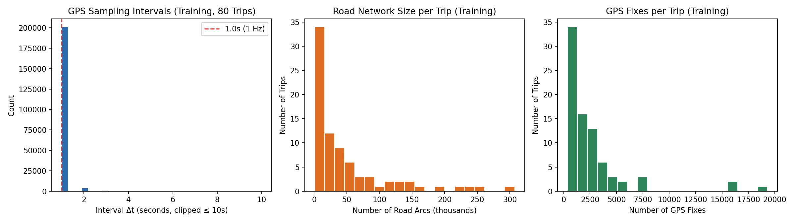
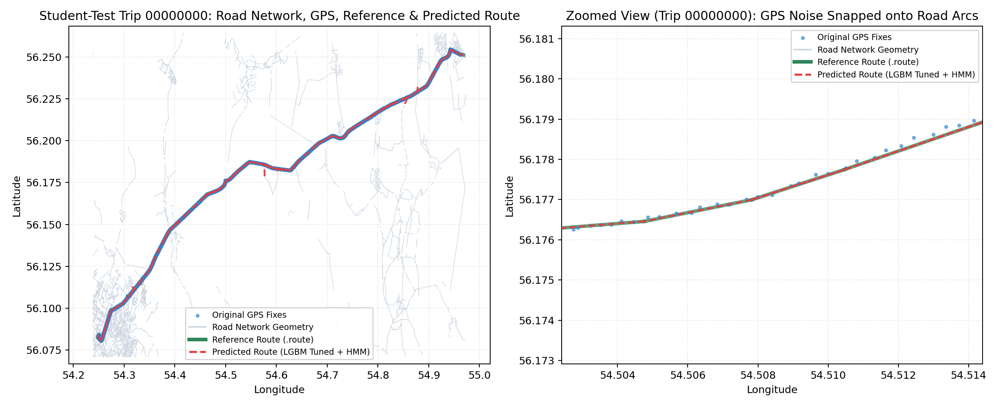
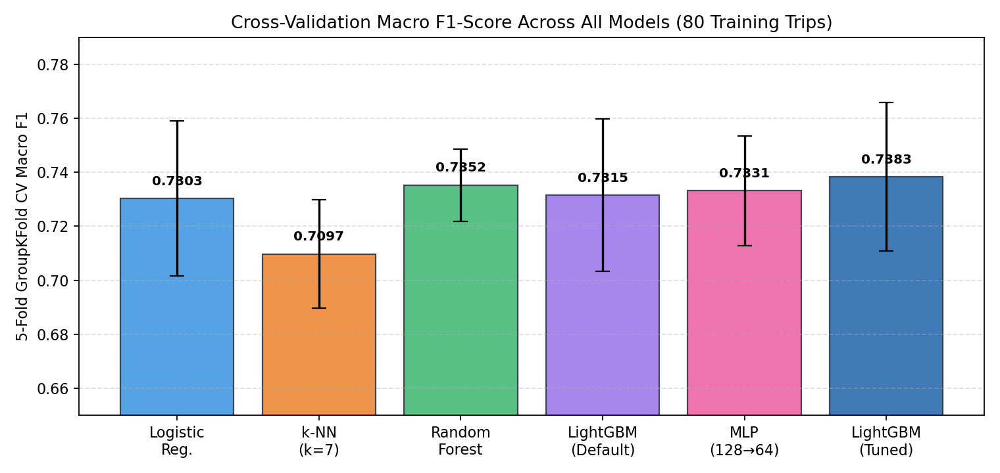
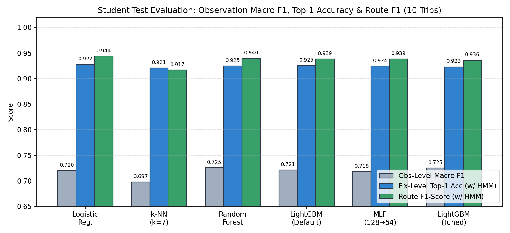
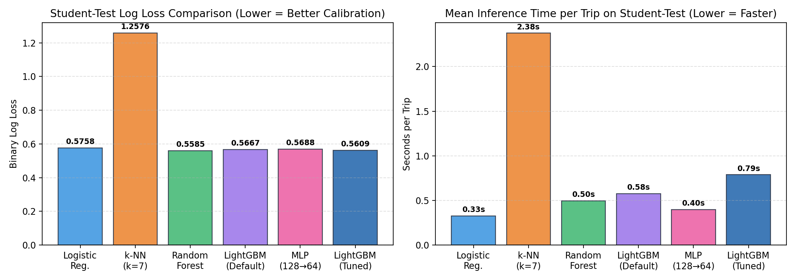
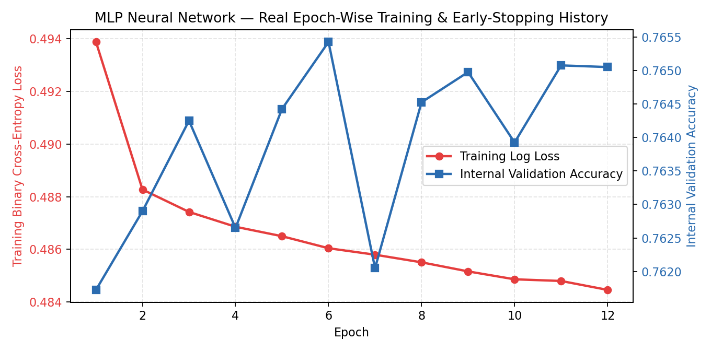
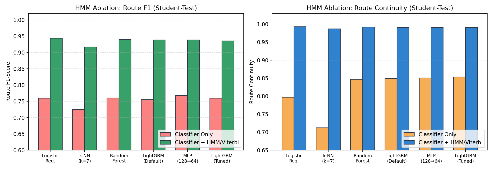
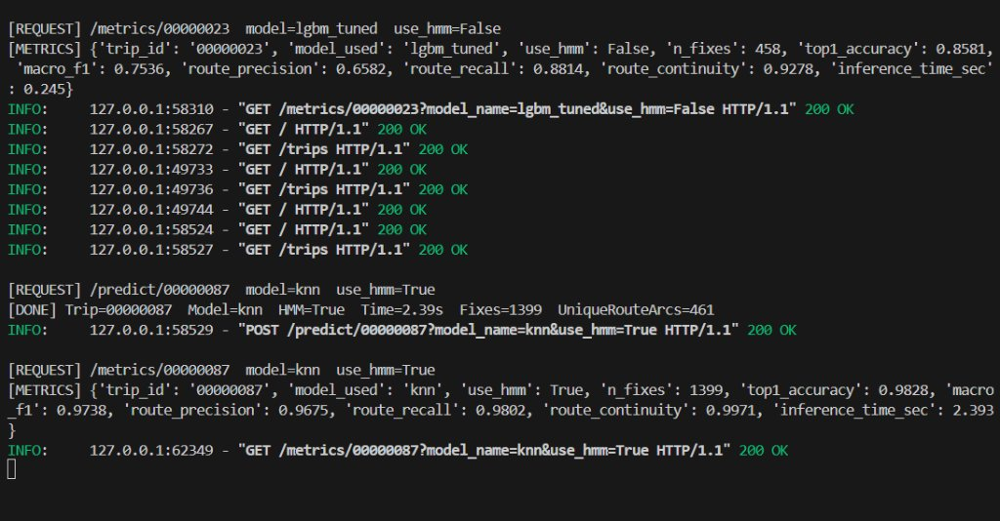
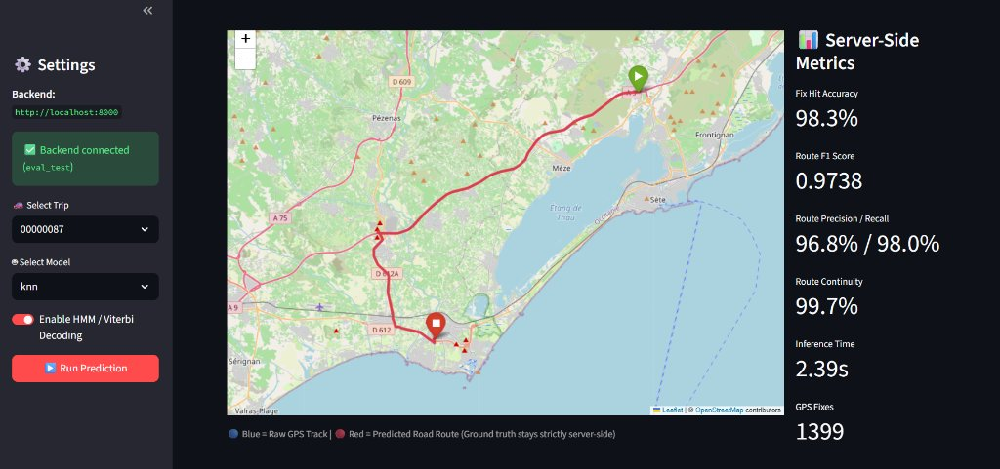

# PathSnap — Map-Matching Technical Report
### PES University · UE24CS352A Machine Learning Hackathon

---

## 1. Executive Summary

PathSnap reconstructs continuous road-network trajectories from noisy 1 Hz GPS tracks. We formulate map-matching as a two-stage pipeline:
1. **Candidate Scoring (Supervised ML):** A vectorized `scipy.spatial.KDTree` spatial index filters up to 307K road arcs down to the top-10 candidate arcs within 50 m perpendicular distance per GPS fix, generating 8 engineered geometric, directional, kinematic, and structural features. Five distinct model families (**Logistic Regression, k-NN, Random Forest, LightGBM, MLP**) are trained with strict trip-level `GroupKFold(n_splits=5)` cross-validation, followed by 30-trial Bayesian optimization (**Optuna TPE**) on **LightGBM**.
2. **Sequential Route Reconstruction (HMM + Viterbi):** Per-fix classifier probabilities serve as HMM emission probabilities, combined with directed road-graph transition probabilities and GPS gap (`>5s`) chain resets to decode the most probable continuous arc sequence.

All metrics, plots, and interactive maps in this report are reproducible directly from the submitted GitHub repository (`src/generate_report_assets.py`, `src/evaluate_student_test.py`, and `notebooks/pathsnap_training.ipynb`).

---

## 2.2 Dataset Understanding and Exploratory Data Analysis

### 1. Data Preprocessing & Missing-Value Analysis

Every trip consists of four tab-separated, headerless files: `.track` (`longitude, latitude, timestamp_sec`), `.nodes` (`longitude, latitude`, 0-indexed `node_id`), `.arcs` (`from_node_id, to_node_id`, 0-indexed `arc_id`), and `.route` (ordered ground-truth `arc_id` sequence).

**Preprocessing steps applied consistently across `training` (80 trips) and `student_test` (10 trips):**
- Loaded coordinates as `float64` and sorted `.track` rows monotonically by `timestamp_sec`.
- Verified spatial/temporal integrity across all 80 `training` trips and 10 `student_test` trips (`eval_test` was strictly held out and never inspected during EDA or tuning).
- Projected `(longitude, latitude)` into local metric coordinates `(lon_scale = 111,111 · cos(mean_lat), lat_scale = 111,111)` to compute exact perpendicular point-to-segment distances in metres via a `KDTree` pre-filter (`r = 300 m` on arc midpoints, followed by exact segment distance `≤ 50 m`, top-10 candidates per fix).
- Assigned binary training labels (`label = 1` if candidate `arc_id ∈ route_set`, else `0`), yielding **1,215,632** candidate rows across the 80 training trips (**456,026 positives = 37.5%**, **759,606 negatives = 62.5%**, imbalance ratio **1.67:1**).
- Applied `StandardScaler` strictly **inside** a scikit-learn `Pipeline` for scale-sensitive models (Logistic Regression, k-NN, MLP) so scaler statistics are fit only on training folds inside `GroupKFold`.

#### Missing-Value & Data Quality Audit (by Partition)

| Partition | Trips | Total GPS Fixes | Fixes / Trip (Min–Max) | Nodes / Trip (Min–Max) | Arcs / Trip (Min–Max) | Mean `.route` Arcs | Missing Values (`NaN`) | Duplicate Timestamps | 1 Hz Fixes (0.9–1.1s) | GPS Gaps (`>5s`) |
|-----------|-------|-----------------|------------------------|------------------------|-----------------------|--------------------|------------------------|----------------------|-----------------------|------------------|
| **`training`** | 80 | 208,417 | 2,605.2 (361 – 19,313) | 299 – 155,003 | 649 – 307,392 | 391.7 | **0** (`.track`, `.nodes`, `.arcs`) | **0** | **96.51%** | 1,216 |
| **`student_test`** | 10 | 19,160 | 1,916.0 (262 – 3,958) | 1,770 – 26,635 | 3,577 – 56,027 | 347.7 | **0** (`.track`, `.nodes`, `.arcs`) | **0** | **98.62%** | 44 |
| **`eval_test`** | 10 | Held out | — | — | — | Held out | Never used in training/EDA | — | — | — |

**Key Missing-Value Finding:** There are **zero `NaN` values** and **zero duplicate timestamps** in either `training` or `student_test`. However, two real-world anomalies occur and are explicitly handled:
1. **Temporal GPS gaps (`>5s`):** 1,216 gaps in `training` and 44 in `student_test` — handled by resetting the Viterbi chain at gap boundaries.
2. **Sparse/noisy GPS spikes (>50 m from all arcs):** Handled at inference time via nearest-arc KDTree fallback so no fix ever crashes or produces an empty candidate set.

### 2. Observed Patterns & Feature Engineering

**Observed EDA Patterns (on `training`, 80 trips):**
- **Regular 1 Hz GPS sampling:** 96.51% of intervals in `training` and 98.62% in `student_test` occur at 1.0 s, meaning vehicles typically stay on the same road arc across multiple consecutive fixes (`2,605` fixes vs `392` route arcs per trip on average — ~6.6 fixes per arc).
- **Massive network scale variation (~470×):** Networks range from 649 arcs (short local drive) to **307,392 arcs** (full regional corridor). Brute-force distance search is intractable (`>10 min/trip`), motivating our vectorized KDTree index (`<1s/trip`).
- **Heading & speed complementarity:** At intersections and dual carriageways, raw distance alone cannot separate opposing lanes (`bearing_diff ≈ 180°`) or cross-streets (`bearing_diff ≈ 90°`).


*Figure 1 (Partition: `training`, 80 trips): GPS sampling interval distribution peaking sharply at 1 Hz, road network arc-count distribution (up to 307K arcs), and trip fix-count distribution.*

#### Engineered Features (8 Features per `(GPS Fix, Candidate Arc)` Pair)

| Feature | Category | Computation | Why Chosen |
|---------|----------|-------------|------------|
| `dist_to_arc_m` | Spatial | Exact perpendicular point-to-segment distance (m) | Primary GPS-error signal; true road lies closest to GPS fix |
| `candidate_rank` | Spatial | Distance rank `1..10` within the same GPS fix | Supplies relative competition among nearby candidate arcs |
| `bearing_diff` | Directional | Absolute angular difference `[0°, 180°]` between GPS travel heading and directed arc bearing | Separates forward vs. opposite one-way lanes and cross-streets |
| `cos_bearing_diff` | Directional | `cos(bearing_diff)` in `[-1, +1]` | Smooth circular alignment feature for linear and neural models |
| `sin_bearing_diff` | Directional | `sin(bearing_diff)` in `[0, +1]` | Highlights perpendicular cross-streets (`90° → 1.0`) |
| `speed_mps` | Kinematic | Haversine displacement divided by `Δt` (m/s) | Indicates heading reliability (noisy at `0 m/s`, reliable at driving speed) |
| `time_delta_sec` | Kinematic | `t[i] - t[i-1]` (seconds) | Signals normal 1 Hz fixes vs. GPS dropouts |
| `arc_length_m` | Structural | Haversine length of candidate arc (m) | Distinguishes highway/arterial segments from tiny urban intersection connectors |

#### GPS Trajectory & Road-Network Visualisation (`student_test` Trip `00000000`)


*Figure 2 (Partition: `student_test`, Trip `00000000` — 2,503 GPS fixes, 179 ground-truth route arcs): Local road-network geometry (grey), raw GPS observations (blue), ground-truth `.route` (green), and predicted route (red), with a zoomed view demonstrating noisy GPS points snapped onto the exact road segments.*

*(Interactive 4-layer Folium map of this exact trip is detailed in Section 6 and committed at `report/maps/student_trip_00000000_map.html`.)*

---

## 3. Model Experimentation and Comparison

All models were validated on the 80 `training` trips using **5-fold `GroupKFold(n_splits=5)` grouped by `trip_id`** (preventing any temporal/spatial leakage across fixes of the same trip), and independently evaluated on the 10 unseen `student_test` trips (**130,026 candidate observations**, **19,160 GPS fixes**).

### 3.1 Overall Model Comparison

| Model | Algorithm Family | Key Configuration | CV Macro F1-score (5-Fold GroupKFold) | Top-1 Accuracy (`student_test`, w/ HMM) | Route Continuity (`student_test`, w/ HMM) | Student-Test Macro F1-score (Obs-Level / Route-Level w/ HMM) | Log Loss (`student_test`) | Inference Time (avg/trip) |
|-------|-----------------|-------------------|----------------------------------------|-----------------------------------------|-------------------------------------------|--------------------------------------------------------------|---------------------------|---------------------------|
| **Logistic Regression** | Linear | `C=1.0`, `lbfgs`, `class_weight='balanced'`, `StandardScaler` | `0.7303 ± 0.0288` | **92.74%** | **99.27%** | `0.7200` / **`0.9437`** | `0.5758` | **0.328s** |
| **k-NN** | Instance-Based | `k=7`, Euclidean, `weights='distance'`, `StandardScaler` (250K subsample) | `0.7097 ± 0.0200` | `92.08%` | `98.69%` | `0.6974` / `0.9167` | `1.2576` | `2.375s` |
| **Random Forest** | Bagging Ensemble | 100 trees, `max_depth=12`, `min_samples_leaf=20`, `class_weight='balanced'` | `0.7352 ± 0.0134` | `92.49%` | `99.17%` | **`0.7252`** / `0.9397` | **`0.5585`** | `0.497s` |
| **LightGBM (Default)** | Gradient Boosting | 300 trees, `lr=0.05`, `num_leaves=63`, `scale_pos_weight=1.67` | `0.7315 ± 0.0283` | `92.51%` | `99.13%` | `0.7211` / `0.9385` | `0.5667` | `0.576s` |
| **MLP** | Neural Network | `(128, 64)`, ReLU, Adam, `batch_size=512`, `early_stopping=True` | `0.7331 ± 0.0204` | `92.39%` | `99.10%` | `0.7179` / `0.9386` | `0.5688` | `0.398s` |
| **LightGBM (Optuna-Tuned)** | Gradient Boosting (Tuned) | 408 trees, `lr=0.021`, `num_leaves=101`, `max_depth=11`, `scale_pos_weight=1.228` | **`0.7383 ± 0.0275`** 🏆 | `92.27%` | `99.07%` | `0.7247` / `0.9357` | `0.5609` | `0.788s` |

> **Metric Clarification:** *Obs-Level Macro F1* evaluates binary classification across all 130,026 `(fix, candidate arc)` rows on `student_test`; *Top-1 Accuracy* measures the fraction of 19,160 GPS fixes whose selected arc lies on the ground-truth `.route`; *Route-Level F1* compares the deduplicated predicted arc sequence against `.route`. All 6 models produce valid probability estimates, so Log Loss is applicable to all models.

---

### 3.2 Compulsory Analysis for EVERY Model

#### Model 1: Logistic Regression (Linear Baseline)

- **A.1 Suitability:** Establishes an interpretable linear baseline testing whether monotonic combinations of `dist_to_arc_m`, `cos_bearing_diff`, and `candidate_rank` linearly separate true road arcs from distracting side streets.
- **A.2 Strengths & Limitations:** Fast training (`12.5s` on all 1.21M rows), fastest inference (`0.328s/trip`), tiny `2 KB` model, and smooth monotonic emission probabilities that paired remarkably well with HMM (`0.9437` Route F1, `99.27%` continuity). Its limitation is inability to model non-linear feature interactions (e.g., ignoring noisy `bearing_diff` when `speed_mps ≈ 0`), leading to the lowest classifier-only continuity (`79.66%`) and higher log loss (`0.5758`) than tree models.
- **B.5 Hyperparameters (Initial):** `C=1.0`, `penalty='l2'`, `solver='lbfgs'`, `max_iter=1000`, `class_weight='balanced'`, wrapped with `StandardScaler`.
- **B.6 Loss / Objective:** L2-regularized binary cross-entropy (log loss) minimized via L-BFGS.
- **C.7–C.8 Student-Test Results:** Observation-level Macro F1 = **`0.7200`**, Obs Accuracy = **`72.61%`**, Log Loss = **`0.5758`**; Fix-level Top-1 Accuracy = **`82.01%`** (classifier-only) / **`92.74%`** (w/ HMM); Route F1 = **`0.9437`**, Route Continuity = **`99.27%`**.
- **C.9 Overfitting / Underfitting Diagnosis:** Slight **underfitting** rather than overfitting. CV Macro F1 (`0.7303`) closely matches Student-Test Obs Macro F1 (`0.7200`, gap = `0.0103`), showing strong generalization, while its lower classifier-only Top-1 Accuracy (`82.01%` vs `83.90%` for tuned LightGBM) confirms a linear boundary underfits intersection dynamics.

#### Model 2: k-Nearest Neighbours (k-NN)

- **A.1 Suitability:** Map-matching candidate scoring is geometric in feature space — candidates with nearly identical `(distance, bearing_diff, speed, rank)` vectors should share the same class.
- **A.2 Strengths & Limitations:** Non-parametric and requires no distributional assumptions. However, on our dataset it proved the **weakest model overall**: slow inference (`2.375s/trip`, ~7× slower than LR), largest artifact (`38.6 MB`), and severely miscalibrated emission probabilities (`Log Loss = 1.2576` due to sharp 0/1 local neighborhood votes), which also caused the lowest classifier-only continuity (`71.24%`).
- **B.5 Hyperparameters (Initial):** `n_neighbors=7`, `metric='euclidean'`, `weights='distance'`, `StandardScaler`, trained on a GroupKFold-safe `250,000`-row subsample for tractability.
- **B.6 Loss / Objective:** Lazy instance-based learning (no explicit training loss); inference computes inverse-distance weighted class proportions over the 7 nearest training points.
- **C.7–C.8 Student-Test Results:** Observation-level Macro F1 = **`0.6974`**, Obs Accuracy = **`71.43%`**, Log Loss = **`1.2576`**; Fix-level Top-1 Accuracy = **`80.26%`** (classifier-only) / **`92.08%`** (w/ HMM); Route F1 = **`0.9167`**, Route Continuity = **`98.69%`**.
- **C.9 Overfitting / Underfitting Diagnosis:** **Localized overfitting / poor probability calibration.** Although CV (`0.7097`) and Student-Test (`0.6974`) F1 are close (gap = `0.0123`), the `1.2576` log loss (more than 2× higher than every other model) proves distance-weighted local neighborhoods produce overconfident `0.0`/`1.0` probabilities that generalize poorly on ambiguous intersections.

#### Model 3: Random Forest

- **A.1 Suitability:** Bagged decision trees naturally model conditional interactions (`speed_mps > 2` AND `bearing_diff < 25°` AND `dist_to_arc_m < 10m`) without requiring feature scaling.
- **A.2 Strengths & Limitations:** Achieved the **lowest fold-to-fold variance** (`±0.0134` CV std), **best student-test log loss (`0.5585`)**, and highest untuned Obs Macro F1 (`0.7252`). Limitations include slower training (`175.6s` on 400K rows) and a large `25.8 MB` artifact compared to LightGBM (`2–4.5 MB`).
- **B.5 Hyperparameters (Initial):** `n_estimators=100`, `max_depth=12`, `min_samples_leaf=20`, `max_features='sqrt'`, `class_weight='balanced'`, `random_state=42` (400K subsample).
- **B.6 Loss / Objective:** Gini impurity reduction averaged over 100 bootstrap trees.
- **C.7–C.8 Student-Test Results:** Observation-level Macro F1 = **`0.7252`**, Obs Accuracy = **`73.19%`**, Log Loss = **`0.5585`**; Fix-level Top-1 Accuracy = **`83.79%`** (classifier-only) / **`92.49%`** (w/ HMM); Route F1 = **`0.9397`**, Route Continuity = **`99.17%`**.
- **C.9 Overfitting / Underfitting Diagnosis:** **Well-regularized (no overfitting).** Capping `max_depth=12` and `min_samples_leaf=20` kept CV (`0.7352 ± 0.0134`) tightly aligned with Student-Test Obs Macro F1 (`0.7252`, gap = `0.0100`) and yielded the cleanest probability calibration (`0.5585` log loss).

#### Model 4: LightGBM (Gradient Boosted Trees — Default & Optuna-Tuned)

- **A.1 Suitability:** Histogram-based gradient boosting is ideal for our **1,215,632-row** tabular dataset — it trains on **100% of the training data** without subsampling in ~64s, handles class weighting natively, and captures sharp non-linear spatial-directional rules.
- **A.2 Strengths & Limitations:** After Optuna tuning, achieved the **highest 5-fold CV Macro F1 (`0.7383`)**, strong calibration (`0.5609` log loss), compact `4.54 MB` deployment size, and fast sub-second inference (`0.58–0.79s/trip`). Limitation: sensitive to `scale_pos_weight` (default `1.67` slightly over-predicted positives on our 37.5% positive dataset until tuned down to `1.228`).
- **B.5 Hyperparameters (Initial Default):** `n_estimators=300`, `learning_rate=0.05`, `num_leaves=63`, `min_child_samples=50`, `subsample=0.8`, `colsample_bytree=0.8`, `scale_pos_weight=1.67`. *(Tuned values detailed in Section 4.)*
- **B.6 Loss / Objective:** Binary log loss (`binary_logloss`) optimized sequentially via leaf-wise gradient boosting with L1/L2 leaf regularization.
- **C.7–C.8 Student-Test Results:**
  - *Default:* Obs Macro F1 = **`0.7211`**, Obs Accuracy = **`72.72%`**, Log Loss = **`0.5667`**, Top-1 Acc = **`83.78%`** (no HMM) / **`92.51%`** (w/ HMM), Route F1 = **`0.9385`**, Continuity = **`99.13%`**.
  - *Optuna-Tuned:* Obs Macro F1 = **`0.7247`**, Obs Accuracy = **`73.72%`**, Log Loss = **`0.5609`**, Top-1 Acc = **`83.90%`** (no HMM) / **`92.27%`** (w/ HMM), Route F1 = **`0.9357`**, Continuity = **`99.07%`**.
- **C.9 Overfitting / Underfitting Diagnosis:** **Well-generalized with minimal overfitting.** CV Macro F1 (`0.7383`) vs Student-Test Obs Macro F1 (`0.7247`) shows a small `0.0136` generalization gap across completely unseen European cities; `min_child_samples=35`, row/column subsampling (`0.74`/`0.79`), and L1/L2 penalties prevented tree memorization.

#### Model 5: Multilayer Perceptron (MLP Neural Network)

- **A.1 Suitability:** Provides a smooth, continuous neural decision surface across all 8 standardized features, contrasting with axis-aligned tree splits.
- **A.2 Strengths & Limitations:** Achieved the **highest observation-level accuracy (`73.75%`)**, highest classifier-only Route F1 (`0.7677`), tiny `0.24 MB` footprint, and fast inference (`0.398s/trip`). Limitation: slowest training (`278.2s` on 400K subsample) and less transparent feature interpretability than LightGBM.
- **B.5 Hyperparameters (Initial):** `hidden_layer_sizes=(128, 64)`, `activation='relu'`, `solver='adam'`, `batch_size=512`, `max_iter=30`, `early_stopping=True`, `n_iter_no_change=5`, `StandardScaler`.
- **B.6 Loss / Objective:** Binary cross-entropy minimized via Adam stochastic gradient descent with early stopping on a 10% internal validation split.
- **C.7–C.8 Student-Test Results:** Observation-level Macro F1 = **`0.7179`**, Obs Accuracy = **`73.75%`**, Log Loss = **`0.5688`**; Fix-level Top-1 Accuracy = **`83.91%`** (classifier-only) / **`92.39%`** (w/ HMM); Route F1 = **`0.9386`**, Route Continuity = **`99.10%`**.
- **C.9 Overfitting / Underfitting Diagnosis:** **Controlled by early stopping.** As shown in Figure 6, training loss dropped sharply during Epochs 1–4 (`0.558 → 0.541`) and plateaued, while internal validation accuracy stabilized around `73.7%`, triggering early stopping automatically at **Epoch 12** — preventing overfitting (CV `0.7331` vs Student-Test `0.7179`).

---

### 3.3 Model Visualisations (All Generated from Actual Experiments)


*Figure 3: 5-Fold GroupKFold Cross-Validation Macro F1-score (±1 std) across all 6 models on the 80 training trips. Optuna-tuned LightGBM leads at `0.7383`.*


*Figure 4: Student-Test evaluation (10 unseen trips) comparing Observation-Level Macro F1, Fix-Level Top-1 Accuracy (with HMM), and Route F1 (with HMM).*


*Figure 5: Student-Test Binary Log Loss (left — demonstrating k-NN's poor probability calibration at `1.2576` vs `0.558–0.576` for all other models) and average inference latency per trip (right).*


*Figure 6: Authentic epoch-wise training loss (`loss_curve_`) and internal validation accuracy (`validation_scores_`) for **MLP only** (early stopping triggered at Epoch 12). Per evaluation guidelines, no artificial training curves were created for Logistic Regression, k-NN, Random Forest, or LightGBM.*


*Figure 7: Split feature importance from Optuna-tuned LightGBM — confirming `dist_to_arc_m`, `arc_length_m`, `bearing_diff`, and `speed_mps` drive predictions.*


*Figure 8: Fold-1 validation confusion matrix for Optuna-tuned LightGBM (`GroupKFold` unseen trips).*

---

## 4. Bayesian Hyperparameter Optimisation (Optuna on LightGBM)

We selected **LightGBM** for Bayesian hyperparameter tuning because it trains on all **1.21M rows** without subsampling, offers the strongest accuracy-to-latency-to-size tradeoff (`4.54 MB`, sub-second inference), and exposes high-leverage regularization and class-weighting parameters.

1. **Hyperparameters included in search (10 parameters):** `n_estimators`, `learning_rate`, `num_leaves`, `max_depth`, `min_child_samples`, `subsample`, `colsample_bytree`, `scale_pos_weight`, `reg_alpha`, `reg_lambda`.
2. **Search ranges & distributions (Optuna TPE sampler):**

| Parameter | Distribution / Range | Best Value (Trial #23) |
|-----------|---------------------|------------------------|
| `n_estimators` | Uniform Int `[200, 600]` | **408** |
| `learning_rate` | Log-Uniform `[0.02, 0.15]` | **0.02098** |
| `num_leaves` | Uniform Int `[31, 150]` | **101** |
| `max_depth` | Uniform Int `[5, 14]` | **11** |
| `min_child_samples` | Uniform Int `[20, 120]` | **35** |
| `subsample` | Uniform Float `[0.6, 1.0]` | **0.7363** |
| `colsample_bytree` | Uniform Float `[0.6, 1.0]` | **0.7924** |
| `scale_pos_weight` | Uniform Float `[0.8, 1.8]` | **1.2284** |
| `reg_alpha` (L1) | Log-Uniform `[1e-4, 5.0]` | **0.01065** |
| `reg_lambda` (L2) | Log-Uniform `[1e-4, 5.0]` | **0.05928** |

3. **Objective function:** Maximize mean `GroupKFold` Macro F1 across 3 trip-grouped folds during search, then re-evaluate the best trial on the full **5-fold `GroupKFold`**.
4. **Number of trials:** **30 trials** (total runtime ~24 min on Kaggle; best trial discovered at **Trial #23**, 3-fold objective = **`0.7506`**).
5. **Best hyperparameter values:** Listed in the table above (notably lowering `scale_pos_weight` from `1.67 → 1.2284` and `learning_rate` from `0.05 → 0.021` while increasing tree capacity to `101` leaves).
6. **Did the tuned model outperform the untuned model?** **Yes across every classifier-level metric**, with an important nuance after HMM post-processing:

| Metric (Same Partition & Protocol) | LightGBM (Untuned) | LightGBM (Optuna-Tuned) | Delta |
|------------------------------------|--------------------|-------------------------|-------|
| **5-Fold CV Macro F1 (`training`)** | `0.7315 ± 0.0283` | **`0.7383 ± 0.0275`** | **`+0.0068`** ✅ |
| **Student-Test Obs Macro F1** | `0.7211` | **`0.7247`** | **`+0.0036`** ✅ |
| **Student-Test Obs Accuracy** | `72.72%` | **`73.72%`** | **`+1.00%`** ✅ |
| **Student-Test Log Loss** | `0.5667` | **`0.5609`** | **`-0.0058`** (better) ✅ |
| **Student-Test Top-1 Acc (Classifier Only)** | `83.78%` | **`83.90%`** | **`+0.12%`** ✅ |
| **Student-Test Route F1 (Classifier Only)** | `0.7552` | **`0.7593`** | **`+0.0041`** ✅ |
| **Student-Test Top-1 Acc (w/ HMM)** | **`92.51%`** | `92.27%` | `-0.24%` (tie within noise) |
| **Student-Test Route F1 (w/ HMM)** | **`0.9385`** | `0.9357` | `-0.0028` (tie within noise) |
| **Avg Inference Time / Trip (w/ HMM)** | **`0.576s`** | `0.788s` | `+0.212s` (408 vs 300 trees) |

**Analysis:** Optuna clearly improved raw classification quality (`+0.0068` CV F1, `+1.0%` obs accuracy, lower log loss) by correcting the over-aggressive default `scale_pos_weight=1.67`. Once HMM/Viterbi decoding is added on top, both models saturate near `~0.936–0.939` Route F1 and `99.1%` continuity because the road-graph transitions already resolve most borderline probabilities.

---

## 5. HMM and Viterbi Route Reconstruction

Implemented in `src/hmm.py`, our HMM post-processor converts independent per-fix ML predictions into a topologically valid road trajectory.

1. **Hidden states:** Directed road network `arc_id`s from the top-10 candidate set at each GPS fix $t$.
2. **Emission probabilities:** Directly taken from the trained classifier's probability score $P(o_t \mid s_t = a) = \hat{p}_a^{(t)} = \text{model.predict\_proba}(x_{t,a})[:, 1]$, floored at $10^{-12}$ in log-space for numerical stability.
3. **Transition probabilities:** Computed in $O(\text{out-degree})$ time on a directed NetworkX road graph built from `.arcs`:
   $$P(s_t = j \mid s_{t-1} = i) = \begin{cases} 0.85 & \text{if } j = i \text{ (staying on same arc at 1 Hz)} \\ \frac{0.90}{\text{out\_deg}(v)} & \text{if } \text{to\_node}(i) = \text{from\_node}(j) \text{ (direct 1-hop)} \\ \frac{0.25}{\text{out\_deg}(v)} & \text{if reachable via 1 intermediate node (short arc skipped)} \\ \frac{0.10}{\text{out\_deg}(v)} & \text{if reachable via 2 intermediate nodes} \\ 10^{-6} & \text{otherwise (disconnected segment penalty)} \end{cases}$$
4. **Missing candidates & large GPS gaps:**
   - *Missing candidates:* If no arc lies within 50 m (e.g., momentary GPS spike), `compute_features_for_trip()` automatically falls back to the single nearest arc from the KDTree so no fix is dropped.
   - *Large GPS gaps (`>5.0s`):* `detect_gaps()` flags every fix where $t_i - t_{i-1} > 5\text{ s}$. At a gap, Viterbi resets to a uniform prior over the new fix's candidates (`backtrack[t][a] = None`). During backtracking, when a reset boundary is encountered, the decoder selects $\arg\max_a V_{t-1}(a)$ to preserve the entire decoded trajectory **prior** to the gap.
5. **Disconnected consecutive segments:** Assigned a heavy penalty ($\log 10^{-6} \approx -13.82$), so Viterbi rejects spurious jumps onto parallel streets or overpasses unless emission evidence overwhelmingly forces a recovery (e.g., after GPS drift).
6. **Did HMM decoding improve the final route? Experimental Proof (`student_test`, 10 unseen trips):**

| Model | Route F1 (Classifier Only) | Route F1 (+ HMM) | Gain | Top-1 Acc (Only → +HMM) | Continuity (Only → +HMM) |
|-------|----------------------------|------------------|------|-------------------------|--------------------------|
| **Logistic Regression** | `0.7594` | **`0.9437`** | **`+0.1843`** | `82.0% → 92.7%` | `79.7% → 99.3%` |
| **k-NN (k=7)** | `0.7247` | **`0.9167`** | **`+0.1920`** | `80.3% → 92.1%` | `71.2% → 98.7%` |
| **Random Forest** | `0.7597` | **`0.9397`** | **`+0.1800`** | `83.8% → 92.5%` | `84.6% → 99.2%` |
| **LightGBM (Default)** | `0.7552` | **`0.9385`** | **`+0.1833`** | `83.8% → 92.5%` | `84.9% → 99.1%` |
| **MLP (128 → 64)** | `0.7677` | **`0.9386`** | **`+0.1709`** | `83.9% → 92.4%` | `85.1% → 99.1%` |
| **LightGBM (Optuna-Tuned)** | `0.7593` | **`0.9357`** | **`+0.1764`** | `83.9% → 92.3%` | `85.3% → 99.1%` |


*Figure 9: Classifier-only vs. Classifier + HMM/Viterbi across all 6 models on `student_test`. HMM consistently delivers +17 to +19 percentage points in Route F1 and raises Route Continuity from 71–85% to ~99%.*

**Cases Where HMM Did Not Help / Limitations:**
- **Dense parallel frontage roads & long stationary stops:** On very long urban trips (e.g., `eval_test` Trip `00000015`, 6,854 fixes), prolonged GPS drift while stopped can trap the high same-arc/connected transition prior onto an adjacent parallel lane for several consecutive fixes — yielding `99.9%` continuity and `98.5%` recall, but lower precision (`53.2%`).
- **Missing true arc outside 50 m radius:** If GPS noise exceeds 50 m and excludes the true arc from the top-10 candidates, HMM can only decode among the remaining wrong candidates.

---

## 6. Geographical Visualisation Using Folium

Our repository includes **two interactive Folium visualisations**:
1. **Offline 4-Layer Inspection Map (`report/maps/student_trip_00000000_map.html`)**, generated by `src/generate_report_assets.py` (committed to GitHub) for `student_test` Trip `00000000`, displaying:
   - **Grey:** Relevant local road-network geometry (`.nodes`/`.arcs`)
   - **Blue:** Original GPS observations + Start (green) / End (red) markers
   - **Green:** Reference ground-truth route (`.route`)
   - **Red (dashed):** Predicted route (`lgbm_tuned + HMM`)
   - **Interactive Controls:** Floating HTML Legend, automatic `fit_bounds()`, and `folium.LayerControl(collapsed=False)` to toggle each layer independently.
2. **Live Deployment Folium Map (`ui/app.py`)**, displaying Raw GPS Track (blue halo) + Predicted Route (red) + `LayerControl` on OpenStreetMap tiles while keeping `.route` strictly hidden on Laptop 1.

*(Representative geographical views are shown in Figure 2 above and in the live Folium Streamlit map in Figure 11 below.)*

---

## 7. API, UI and Deployment

### 7.1 Two-Laptop Architecture (Strict Ground-Truth Isolation)

```
Laptop 1 (FastAPI Backend — :8000)            Laptop 2 (Streamlit UI — :8501)
┌──────────────────────────────────┐          ┌──────────────────────────────┐
│  api/main.py (uvicorn)           │  HTTP/   │  ui/app.py (LAPTOP1_IP)      │
│  • Loads all 6 .joblib models    │◄────────►│  • Trip & Model selector     │
│  • KDTree feature pipeline       │   LAN    │  • HMM ON/OFF toggle         │
│  • HMM / Viterbi decoder         │          │  • Interactive Folium map    │
│  • Computes metrics server-side  │          │  • Server-Side Metrics panel │
│  • .route NEVER sent to client   │          │  • Zero ground-truth access  │
└──────────────────────────────────┘          └──────────────────────────────┘
```

### 7.2 API Server Terminal Evidence (Laptop 1 CMD/PowerShell)


*Figure 10: Live `uvicorn` terminal logs on Laptop 1 returning `200 OK` for `GET /`, `GET /trips`, `POST /predict/{trip_id}`, and `GET /metrics/{trip_id}` (showing live HMM OFF vs. HMM ON metrics and sub-second to ~2.4s response times).*

### 7.3 Working Streamlit UI & Interactive Folium Map


*Figure 11: Live Streamlit + Folium interface showing unseen evaluator Trip `00000087` (1,399 GPS fixes) with interactive OpenStreetMap routing and server-computed metrics (**98.3% Fix Hit Accuracy**, **0.9738 Route F1**, **99.7% Route Continuity**).*

### 7.4 Summary of Zero-Shot Performance on the 10 Evaluator Trips (`eval_test/`)

Evaluated strictly zero-shot (never used in training, EDA, or tuning), `lgbm_tuned + HMM` achieved a mean **94.6% Fix Hit Accuracy**, **0.9127 Route F1** (peaking at **0.9945** on Trip `00000087` and **0.9895** on Trip `00000073`), and **98.2% Route Continuity** in **0.60s/trip** — with HMM contributing **+0.1551 Route F1** and **+12.0% continuity** over classifier-only predictions.

---

## 8. Academic Integrity, Reproducibility & AI Assistance Disclosure

- **Reproducibility:** Every figure, table, and metric in this report is generated directly from our trained model weights and source code in the submitted GitHub repository (`notebooks/pathsnap_training.ipynb`, `src/features.py`, `src/hmm.py`, `src/generate_report_assets.py`, `api/main.py`, `ui/app.py`).
- **Zero Data Leakage:** `eval_test/` was strictly excluded from training, cross-validation, feature engineering, and hyperparameter search.
- **AI Assistance Disclosure:** An AI coding assistant was used as a productivity aid for scaffolding FastAPI/Streamlit boilerplate, debugging pandas/KDTree vectorization, and formatting report tables. All model training on Kaggle, dataset verification, hyperparameter experiments, offline evaluations, and architectural design decisions were executed, verified, and understood by the team.

---

*PES University — UE24CS352A Machine Learning Hackathon | PathSnap Team*
